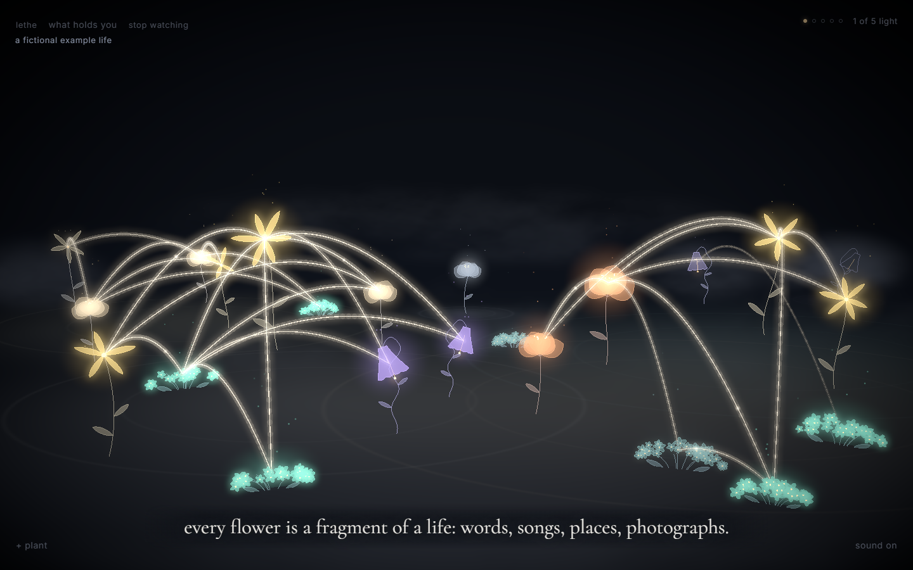
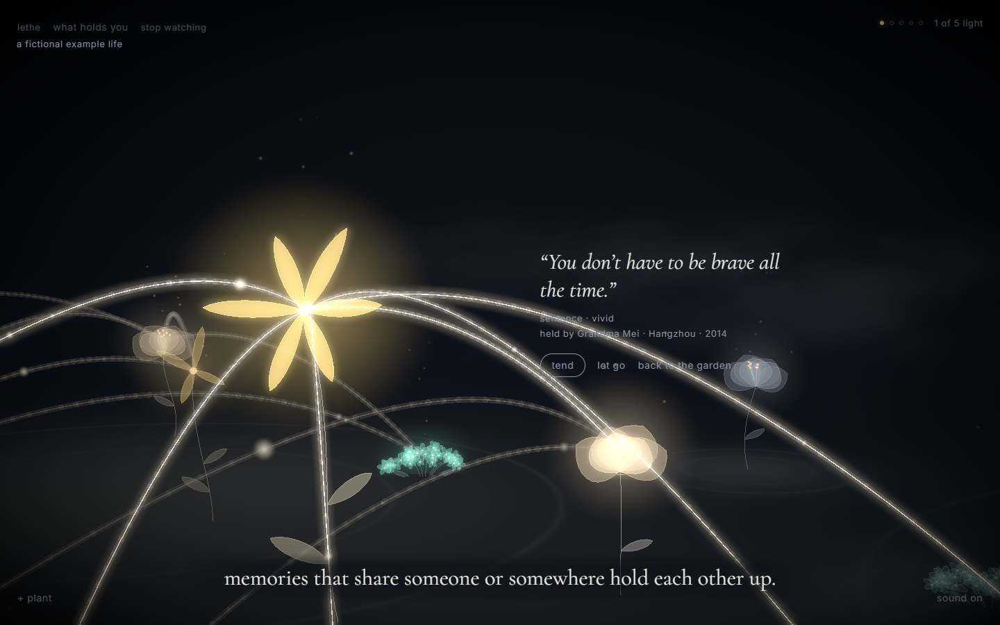
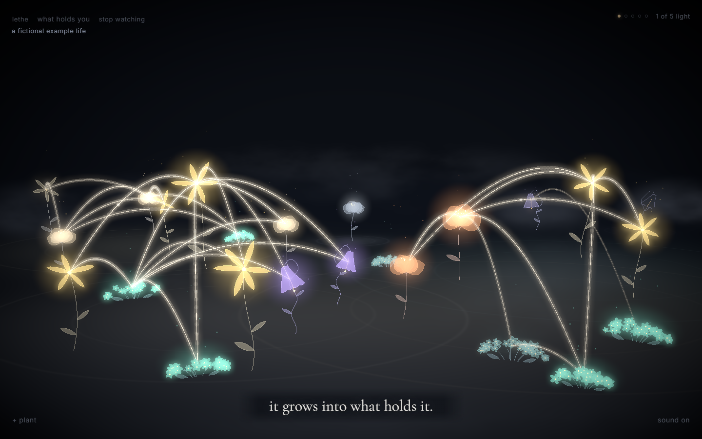
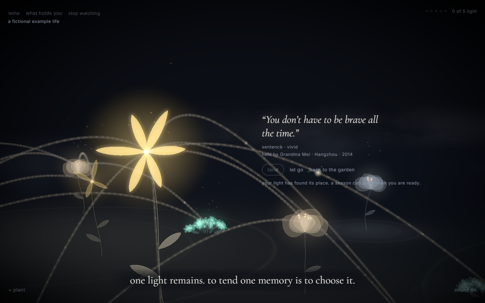
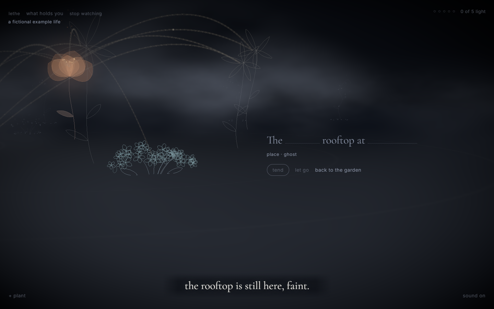
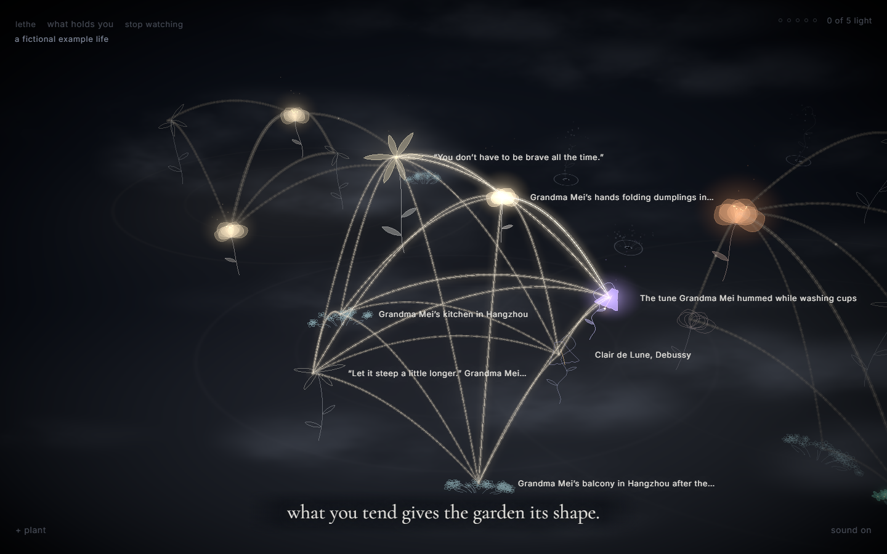

# Lethe

**A garden that forgets.**

Turn fragments of a life into a living night garden. Plant a memory, discover what connects it to other moments, and choose what to tend. As time passes, flowers soften into outlines and seeds. The garden reveals what holds a life together.

[**Play a season**](https://lethe-nine.vercel.app/?demo=play) · [**Watch the three-minute film**](https://lethe-nine.vercel.app/?demo=film) · [**Begin your own garden**](https://lethe-nine.vercel.app/)



## Your life as a world

A sentence your grandmother said. A song she played. Her kitchen after the rain. These fragments may live in different apps and folders, but they belong to the same life.

In Lethe, each memory grows as a flower with a stable identity. Shared people, places and feelings create threads between flowers. Those relationships help memories endure, and tending one also reaches its connected neighbors.

Forgetting leaves a quiet space and a seed. The original words remain. Returning is a choice you can make later.

## Try the contest experience

The example life is fictional: **23 starting memories, one remaining light, and one optional planting**. Planting brings the garden to 24 flowers. Its clock stays paused while you explore, then **let a season pass** advances three fictional garden weeks.

1. Open **play a season**. Hover a flower to read it, then click to come closer.
2. Choose a memory to **tend**. The preview shows the living neighbors your light will reach.
3. **+ plant** offers two authored fragments, or lets you write one yourself. Watch its flower grow and find its threads.
4. **Let a season pass**. See what becomes colorful, faint, or quiet because of your choices.
5. **Continue tending**, **play again**, or **begin your own**.

The three-minute film follows real garden actions through two visits to the same fictional life. In the second visit, a new connection helps the rooftop remain as a ghost. Nothing is forced to survive or disappear for the film. Click, scroll, or press a key to take control; hiding the tab pauses playback.

### Moments in the garden

| A memory and its relationships | A new fragment takes root |
|---|---|
|  |  |
| Read the words before deciding what to tend. | A new memory finds its place in the existing life. |

| Care travels through threads | The same life after a season |
|---|---|
|  |  |
| The answering flowers are actual neighbors in the simulation. | A different connection can leave a different garden. |



## Controls

| Action | Control |
|---|---|
| Read or open a memory | Hover or click a flower; keyboard focus and Enter also work |
| Plant a fragment | **+ plant** or **N** |
| Turn the view | Drag; **Q / E** also turn |
| Move across the garden | Right-drag or two fingers; **WASD / arrow keys** also glide |
| Come closer or rise above | Scroll |
| Close a memory or stop watching | **Esc** |
| Mute the garden | **sound on / sound off** |

Use desktop Chrome or Edge with a window around 1440 × 900 or larger. Sound starts after your first interaction. Reduced-motion preferences are respected, and the experience remains understandable when muted.

## Your own garden and privacy

- Personal gardens and photos live in this browser through IndexedDB. The fictional episode stays separate and never replaces your garden.
- No account or provider key is needed. Memory tagging begins locally, and planting does not wait for the network.
- If an optional provider is configured, memory text and known entity information are sent through `/api/tag` for improved tagging. Photos and the full garden are not uploaded for tagging. Provider keys remain on the server.
- Browser storage is local to the device and browser profile. Clearing it removes the personal garden from that browser.

## Run locally

Use Node.js 22.12 or newer, or Node.js 20.19 or newer within the 20.x series.

```bash
npm ci
npm run dev
```

Open the local URL printed by Vite. The garden works without `.env`. For optional provider tagging, copy `.env.example` to `.env` and set `GROQ_API_KEY` or `ANTHROPIC_API_KEY` server-side. If both are configured, the Anthropic provider is selected.

### Verify and build

```bash
npm test
npm run typecheck
npm run sim -- daily
npm run sim -- lazy
npm run sim -- none
npm run build
npm run preview
```

The garden uses an exponential forgetting model. Personal time and daily light follow real-time rules; the contest episode uses an explicitly paused demo clock. See [the garden systems](docs/systems.md) for the formulas and [the decisions](docs/decisions.md) for their trade-offs.

## Built with

React and TypeScript, Three.js through React Three Fiber, Zustand, Dexie, Tone.js, and Vite. Flowers are procedural meshes derived from memory identities. The engine is pure TypeScript with explicit time inputs. The browser tagger uses compromise, with an optional server-side provider upgrade.

## Submission and presentation

- [Contest submission](SUBMISSION.md): topic, design decisions, AI use, credits, and the materials still to attach.
- [Recording guide](docs/contest-kit.md): the current three-minute film, shot timing, sound check, and fallback.
- [Presentation package](docs/presentation/README.md): six-minute showcase, three-minute cut, speaker notes, and PowerPoint files.
- [Architecture](docs/architecture.md) and [scene specification](docs/scene-spec.md): implementation and visual references.

All code, design and content were created during the competition. The example life is fictional. Submission screenshots are captures of the actual garden.
