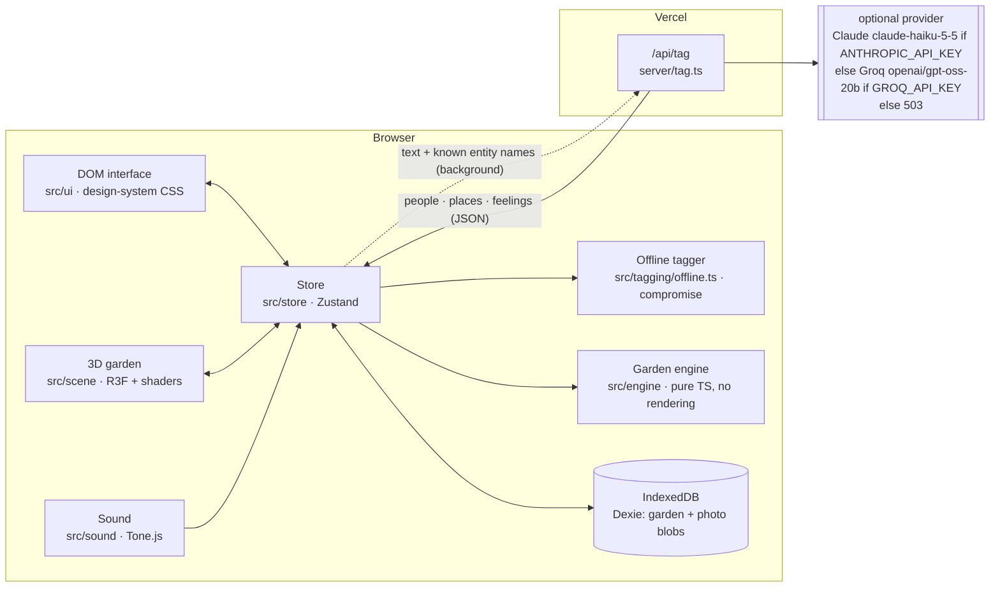
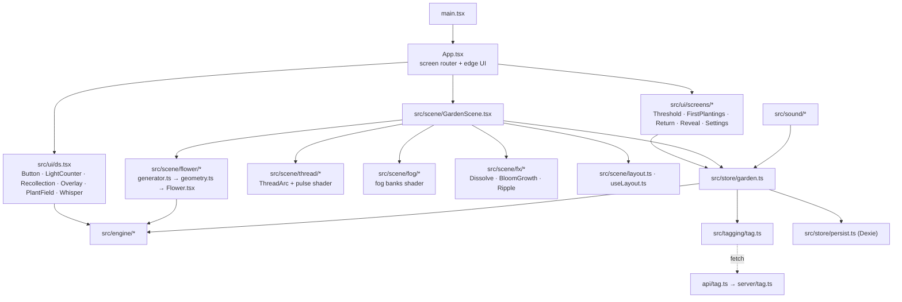
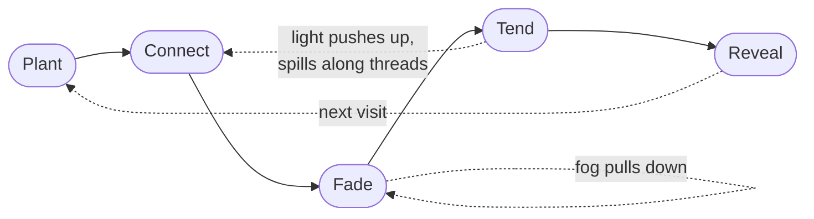
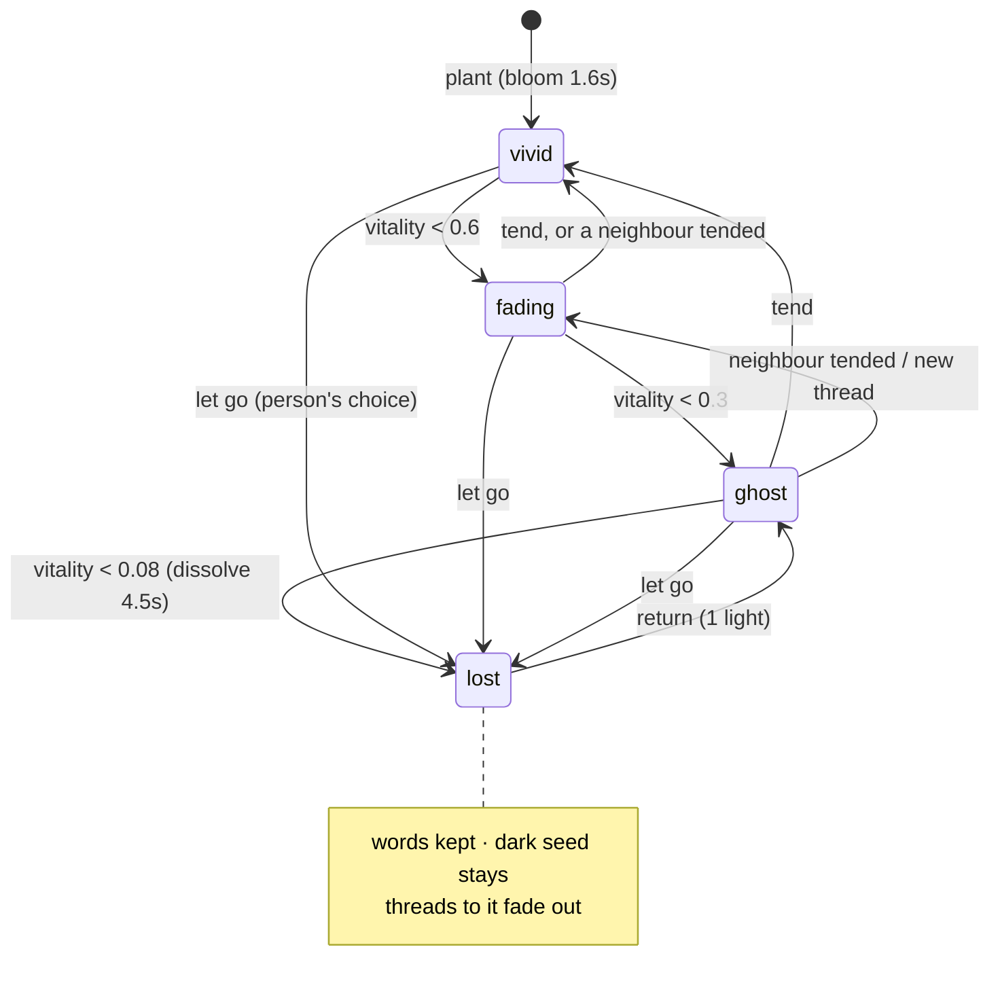
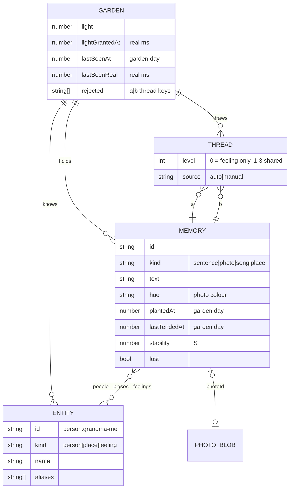
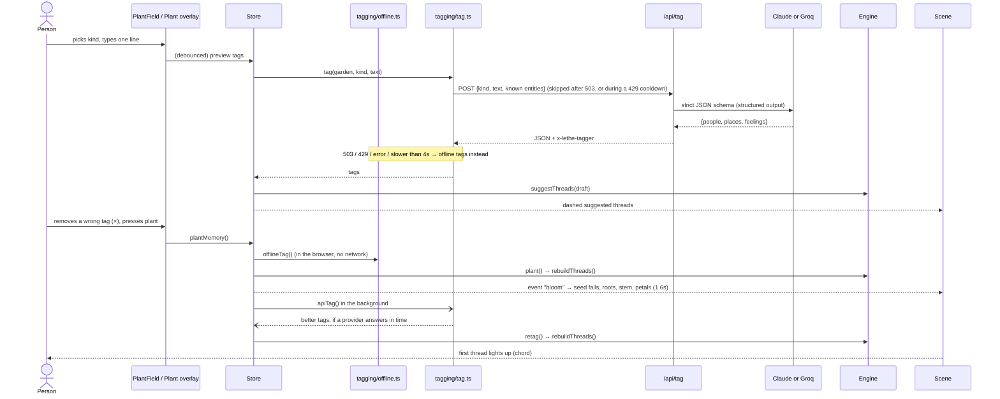
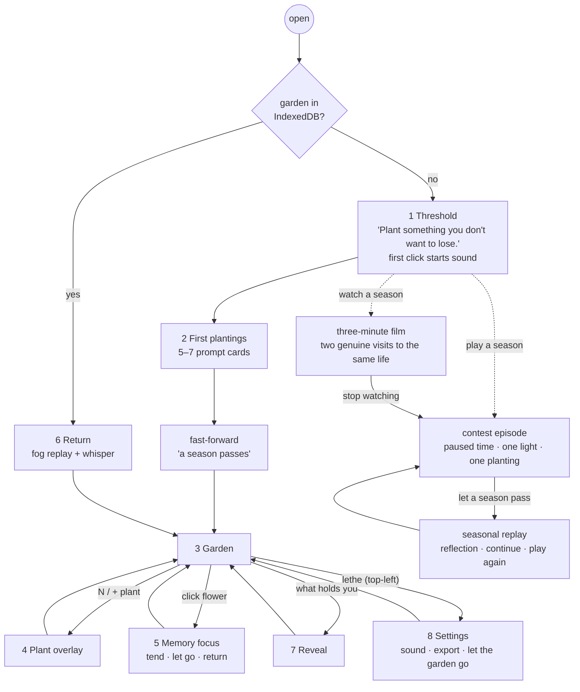
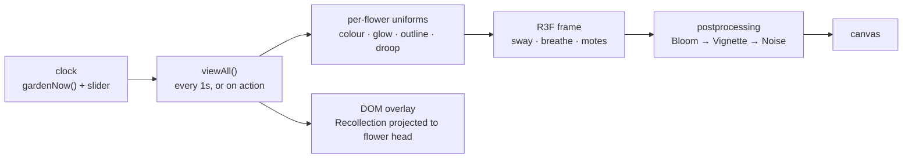

# Architecture

Lethe is a local-first web app. Everything lives in the browser, including tagging: an offline tagger finds people, places and feelings in each memory. If the server has a Groq or Anthropic key, a memory's text (and the names the garden already knows) also goes, briefly, to that provider for better tags. Diagrams are Mermaid: they render on GitHub, and in VS Code with the "Markdown Preview Mermaid Support" extension.

## 1. System overview



**Rule:** the engine never imports React, Three or the store. The store is the only thing that calls the engine. The scene and the UI read *views* (vitality, state) from the store and never compute retention themselves.

## 2. Module map



Files that exist today are the engine, data, store, tagging, `ui/ds.tsx`, `scene/GardenScene.tsx` (skeleton), `scene/layout.ts`, `server/tag.ts` and `api/tag.ts`. The rest are created by tasks in [build-plan.md](build-plan.md).

## 3. The core loop



## 4. Memory states



State changes between visits ease over about 3s, "like dusk falling".

## 5. Data model



Vitality and state are **never stored**. They are derived from `lastTendedAt`, `stability` and the threads at a given `now` (`viewAll(garden, now)`). Layout positions are stored next to the garden once P10 lands.

## 6. Planting a memory



## 7. Returning after time away

```mermaid
sequenceDiagram
  actor P as Person
  participant A as App
  participant S as Store
  participant E as Engine
  participant G as Scene
  P->>A: opens Lethe
  A->>S: load from IndexedDB
  S->>E: visit(garden, now, realNow)
  E->>E: grantLight() · advance(lastSeen → now, step 0.25d)
  E-->>S: ReturnSummary {faded, lost, aboutToBeLost, states before/after}
  S-->>G: replay: render "before" states, then ease each memory to "after" over ~3s with fog rolling in
  G-->>G: lost ones dissolve (4.5s); about-to-be-lost glow once
  S-->>A: Whisper "Four days passed. The library rooftop is about to be lost."
  P->>G: click the glowing ghost → tend (1 light)
```

## 8. Screen flow



The fictional episode never overwrites IndexedDB records belonging to a personal garden. Its film advances through store actions on the presentation clock; hidden-tab intervals pause playback. The original ten-memory reference garden remains at `?demo`.

## 9. Frame pipeline



Views recompute on a 1s tick plus after each action, not every frame. Per-frame work is only animation (sway, breathing, pulses), driven by uniforms.
