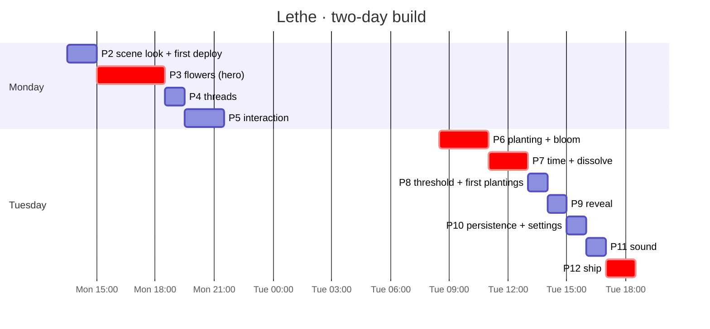

# Build plan

## Contest episode — authorized 13 October

Preserve the completed camera and shader warm-up work. Implement this scope in order; check a task only after its behavior tests and typechecking pass. Reference `?demo` and personal gardens retain their existing rules.

- [x] E1 Authored 23-memory factory, stable layout, and four engine outcome branches.
  - *Built (Codex, finished by Claude):* `src/data/episode.ts` (13 authored memories, two fragments, six long-kept memories at three prior tends, one light) and `src/data/episode.test.ts`: every memory's exact words and tags, genuine threads (e1–m1, e10–m7, none for e13), and four pinned branches (tend Mei + tea: rooftop lost, Mei fading; tend rooftop + tea: rooftop ghost; tend Mei + rooftop fragment: rooftop ghost via its thread to Leo; nothing: rooftop lost, Mei ghost). The rooftop moved to (1290, 760) and its fragment plants at (1140, 720), so it stays visible from the home view (D25).
- [x] E2 Paused episode state, single planting/light, bounded replay, cancellation, and personal isolation.
  - *Built (Codex, finished by Claude):* `episode`, `generation`, `presentation` and the episode actions in `src/store/garden.ts`; `src/store/presentationClock.ts`. Added: `beginEpisode(mode, prepareMs)` + `openEpisode()` so the threshold fades onto the episode's waiting seeds instead of the reference garden (D25). Primary tests `src/store/episode.test.ts` (28): paused clock, a double tend spends once, impossible actions give no feedback, one planting, one season, replay spread ≤ 1.2s, reflection then finished, continue grants light once and three plantings, restart cancels timers, a late tagged planting cannot cross a restart, nothing reaches personal persistence.
- [x] E3 Playable choices, advance/continue/restart, truthful feedback, and keyboard access.
  - *Built (Codex, finished by Claude):* `src/ui/EpisodeControls.tsx`, the fragments step in `PlantOverlay`, reflection lines (`episodeReflection`, tested). Added: tending shows its reach (`useTendReach`, the engine's own neighbours, D25); **let a season pass** is a quiet word, not a pill; <kbd>N</kbd> opens the fragments. *Checked in headless Chrome by keyboard alone:* N → fragment → Enter plants; Tab to a flower → Enter → tend; Esc; let a season pass; continue tending; open the rooftop's seed → return (ghost, light 3 → 2).
- [x] E4 Gesture-started 90-second film, visibility pause, quiet dissolve, and acceptance reveal. (Grown to three minutes in E7.)
  - *Built (Codex, finished by Claude):* `src/ui/story.ts` on the presentation clock. Added: the film opens the prepared episode from the threshold; the strongest holder is read with `holders()` (no reveal toggling); the closing composition dims the rest to 45% (threads 40%), not the reveal's 15% (D25); reduced motion cuts the camera. Tests: plays to its end on real actions and resurrects nothing; stoppable at 12 beats; pauses while hidden. *Checked in headless Chrome:* every caption on its beat (1.4s, 9, 18, 24, 33, 40, 50s; silence 54–81s; closing lines 81 and 86s); approved frames `docs/look-log/20261013-1249-episode-*.png`.
- [x] E5 Regression checks, production build, browser/visual verification, and performance comparison.
  - *Checked:* tests 240/240 green at handoff, typecheck, `npm run sim -- daily|lazy|none` unchanged (25/25, 14/16, 11/25), production build. Playable season in Chrome and in Edge (production build, muted); film in Chrome; keyboard path; Esc stops the film; reduced motion cuts; `?demo` reference unchanged (10 memories, its whisper, no season controls). At rest the episode draws each flower's 2 strongest threads (D19 updated: all threads up to 24). **Performance**, production build, AMD Radeon 610M, DPR 1.5, through the whole film: 80 fps average, median frame 10.6 ms, every beat 62–101 fps on a quiet run; about 1% of frames are GPU-side stalls (0.3–1.2s) at beats, inside three's draw call (shared iGPU, varies run to run), so no code change; record on the RTX (`docs/contest-kit.md` §1).
- [x] E7 The three-minute film, readable captions and colour (owner, 13 Oct; D26).
  - *Built:* `src/ui/story.ts` rewritten as seven acts over 180s with a second season of the same life (`rewind()`, the rooftop planted with Leo instead of the tea; the engine keeps it as a ghost through its thread). Title cards (`FILM_TITLES`, `FilmTitle` in `src/ui/GardenWhisper.tsx`), episode captions in `memory-lg`/`memory` with a night band behind them (`src/styles/app.css`). Pollen in each living flower's colour (`src/scene/fx/Pollen.tsx`) and cluster pools tinted by their flowers (`src/scene/ground/Ground.tsx`). Tests (`src/store/episode.test.ts`, 39): both seasons play to the end with the rooftop a ghost and nothing resurrected; the first season loses it and the film regrows the same life and plays on; a restart from outside still ends the film; stoppable at 21 beats across all acts; pauses while hidden. Suite 251/251, typecheck clean, production build. *Checked in headless Chrome* (production build, 1440 × 900): every caption and title on its beat (title 1.3s after the click; closing lines at 2:40 and 2:46; name at 2:52; ends 3:01), no console errors, stage buttons after the end; median frame 1–8 ms. Approved frames `docs/look-log/20261013-1417-*.png`. Kit §0, §2–§5 and the README rewritten for the 3-minute film.
- [x] E8 Music and louder sound (owner, 13 Oct; D27).
  - *Built:* `src/sound/score.ts` (the waltz: two progressions, melody chance by fog, a stepping melody; tests `src/sound/score.test.ts`, 5) and `src/sound/sound.ts` (the music on its own `Tone.Clock`; glass hover; breaths for open, back, planting and title cards; the wind of a season; what holds you; light gained; levels for laptop speakers, ceiling −3). Suite 256/256, typecheck clean, production build. *Measured* in headless Edge at the output (levels in D27); no console errors or Tone warnings. **Owner:** listen on real speakers (kit §2) and say in words what to change.
- [ ] E6 Contest kit, voiceover, final stills, recordings, and unfamiliar-visitor checks. Recording and visitor checks require the owner when people/audio capture are unavailable.
  - *Claude's part done:* `docs/contest-kit.md` rewritten for the episode (links `?demo=play` and `?demo=film`, the 3-minute script with a live rooftop choice whose outcome the engine confirms, the film's beat table, a 120-word voiceover for the caption gaps, the listing with the plan's description, fictional-life note). Stills: `docs/look-log/20261013-1249-listing-still-{opening,final}[-16x9].png`. **Owner:** listen on speakers (§2), record the film and the narrated version (§3), three unfamiliar visitors, the voting link, and the deploy.

Deferred: three-chapter progression, repeated seasonal grants, bulk imports, and renderer expansion.

**Deadline:** Tuesday 13 October, evening. **Start:** Monday 12 October, about 13:30. That's roughly 18 working hours across two days, in 3D.

The plan is ordered so that **a demoable garden exists at every point after Monday evening**. Each phase ends with a gate: a screenshot or a check. If a gate fails, fix it before moving on, or cut scope below the line. Never carry a broken look into the next phase.

> If "Tuesday" means **20 October**, keep the same order, double every time box, and move the cut line to include all *should* phases plus sound.

## Status

| | Phase | Tier | Box | Status |
|---|---|---|---|---|
| P0 | Setup: repo, deps, docs, CLAUDE.md | must | — | ✅ done |
| P1 | Garden engine + tests + simulation | must | — | ✅ done (16 tests, sim tuned) |
| P2 | Scene look: fog, ground, camera, post | must | 1.5h | ✅ done (deployed at https://lethe-nine.vercel.app) |
| P3 | **Flowers**: procedural Bloom in 3D, 4 kinds × 4 states | must | 3.5h | ✅ done (ghost petals falling built 13 Oct, P13 C5) |
| P4 | Threads: arcs, pulse, motes, hover | must | 1h | ✅ done |
| P5 | Interaction: hover, focus, tend, ripple, whispers | must | 2h | ✅ done |
| P6 | Planting: overlay, tagging, suggested threads, **the bloom** | must | 2.5h | ✅ done |
| P7 | Time: return replay, **the dissolve**, dark seed, return | must | 2h | ✅ done and committed (4fe556b, tests 19aa05d, fa60d07) |
| — | **cut line: below here is optional if behind** | | | |
| P8 | Threshold + first plantings + "a season passes" | should | 1h | ✅ done and committed (30d7c01) |
| P9 | Reveal: "what holds you" | should | 1h | ✅ done and committed (1304539, tests 754375c), except entering by scrolling out (left out on purpose, see P9) |
| P10 | Persistence (Dexie) + settings (export, let the garden go) | should | 1h | ✅ done and committed (6285572, tests 29e1dea) |
| P11 | Sound (Tone.js) | could | 1h | ✅ done (not yet heard on speakers: P13 B3) |
| P12 | Ship: perf, deploy, demo script, look log | must | 1.5h | ✅ done (P12.1a–c open, not needed) |
| P13 | Audition: perf check, look freeze, rule whisper, killer still, kit | must | — | 🟨 deployed and frozen; owner: listen (B3), record (B2/B4) |

## How to work each task

1. Open a fresh Claude Code or Codex session. Paste the phase prompt, then tick the tasks one at a time.
2. **One task per session or commit.** `git commit` after every working step, so a bad change is one revert away.
3. Visual tasks: run `npm run dev`, take a screenshot, compare it to the named screen, and save approved looks to `docs/look-log/YYYYMMDD-HHMM-<what>.png`.
4. After a phase, have the *other* tool review it against `docs/scene-spec.md` and `docs/decisions.md`.
5. Keep `npm test` and `npm run typecheck` green. The engine has no rendering, so test it, don't eyeball it.

---

## P2 · Scene look (1.5h, must)

**Goal:** the empty stage already feels like the screens: night, fog and depth. *Look ref:* screens p3 (garden, no UI) and p14 (empty garden).

- [x] **P2.1 Deploy first (20m).** `npx vercel` → link → (optional) set `GROQ_API_KEY` in project env → deploy. Check that `/api/tag` returns 200 in production. *Done when:* you have a live URL. (De-risks P12.) *Done:* https://lethe-nine.vercel.app, `/api/tag` 200 with Groq (see P12.3).
- [x] **P2.2 Fog banks (40m).** `src/scene/fog/FogBanks.tsx`: 8 camera-facing planes with an fbm noise `ShaderMaterial` in `fog`, opacity 0.06, drifting on 40–90s loops; extra banks at opacity 0.14 in front of ghost flowers. Uniform `uDensity` from the share of faded memories. *Done when:* fog visibly drifts and is thicker over m9 and m10.
- [x] **P2.3 Ground + camera (20m).** Soft radial lighten under each cluster (one shader plane). drei `OrbitControls` with the limits in scene-spec (azimuth ±25°, polar 55–85°, distance 4–16, no pan), damping on, and the drift resuming after 5s idle. Scroll out → overview.
- [x] **P2.4 Post + quality (10m).** Wrap the composer in drei `PerformanceMonitor`; on decline, drop to low quality (scene-spec § Post-processing).
- **Gate:** screenshot vs screen p3. Is it dark enough, the fog soft, nothing grey or "Three.js demo"? Save it to the look log.

> **Prompt:** "Read CLAUDE.md, docs/scene-spec.md (World, Fog, Post-processing) and src/scene/GardenScene.tsx. Do task P2.2 from docs/build-plan.md: create src/scene/fog/FogBanks.tsx and mount it in GardenScene. Use only colours from src/engine/color.ts TOKENS. Show me how to check it visually."

## P3 · Flowers, the hero (3.5h, must)

**Goal:** the four flower families, in four states, look like the design system's Bloom page, standing in 3D. *Look ref:* design-system p12 (Bloom grid), screens p2 (focus flower).

- [x] **P3.1 Generator port (60m).** `src/scene/flower/generator.ts`: port `Bloom` from `lethe-design-system/components/bundle.js` into a pure function `generateFlower(kind, seed, size) → { stems: Vec2[][], petals: {path: Vec2[], at, angle, back}[], leaves, florets, head, anchors }` in a flower-local 2D plane (y up, units = px/100). Reuse `rng` from `src/ui/ds.tsx` (move it to `src/engine/rng.ts`). Add a unit test that the same seed gives the same output. *Done when:* the test passes and the output count matches the SVG (petal count, etc.).
- [x] **P3.2 Geometry + materials (75m).** `src/scene/flower/geometry.ts` builds merged BufferGeometries: stem tubes, cupped petal shapes, outlines, place florets (instanced), and the centre. `src/scene/flower/Flower.tsx` renders them with the per-flower uniforms table, Y-billboarded toward the camera. Replace `PlaceholderFlower` in GardenScene.
- [x] **P3.3 States (40m).** Drive `uColor/uFill/uLine/uGlow/uDroop` from `views` with a 3s lerp. Ghost: outline only. Lost: faint outline plus drifting particles from `anchors` (points, 7–13s drift).
- [x] **P3.4 Halo + sway + breathing (25m).** Halo quad, breathing 7s; seeded sway; centre dot feeds bloom.
- [x] **P3.5 Flower sandbox (20m).** `?sandbox=flowers` renders the 4×4 grid (kinds × states) with a seed input and sliders (size, cup, glow) via `leva` (`npm i leva`). Tune by eye. *Built without leva:* `?sandbox=flowers&seed=m1&size=160`, plus a size slider.
- **Gate:** sandbox screenshot next to design-system p12, and garden screenshot next to screens p3. Each flower should be recognisably its family, and no two alike. Save both.

> **Prompt:** "Read CLAUDE.md, docs/scene-spec.md § Flowers, and the Bloom function in lethe-design-system/components/bundle.js. Do P3.1: port the generator to src/scene/flower/generator.ts as pure data (no SVG, no React) and add a determinism test. Keep the exact rng call order so flowers match their 2D twins."

## P4 · Threads (1h, must)

*Look ref:* screens p1/p3, design-system p13.

- [x] **P4.1 Thread shader (30m).** `src/scene/thread/ThreadArc.tsx`: core + glow lines as in scene-spec; a pulse via a custom line material (or a moving sprite along the curve), period seeded 4–7s; motes when s > 0.3.
- [x] **P4.2 Hover + flicker + suggested style (30m).** Brighten or dim on hover (already in the skeleton), flicker to ghost ends, and a dashed variant for suggested threads (used in P6).
- **Gate:** hover Grandma Mei's sentence → its threads glow and the rest dim. The faint 9–10 thread is barely there. *Passed:* the sentence's two threads light; kitchen–Clair de Lune dims with the rest, since it isn't the hovered flower's thread (design system: "brighten its threads"). Sandbox: `?sandbox=threads`.

## P5 · Interaction (2h, must)

*Look ref:* screens p1 (hover), p2 (focus).

- [x] **P5.1 Recollection beside the flower (40m).** Project the flower head to the screen each frame (`vector.project(camera)`). Place the Recollection `space-3` away on the side with more open ground, with `space-5` clear. Hover uses `memory` (24px); focus uses `size="lg"` (32px) on the right half (screen p2).
- [x] **P5.2 Tend feedback (40m).** On `tend` events: a light mote travels from the LightCounter to the flower (0.6s), the counter dot dims, the flower brightens over 1.2s, and a ripple runs along each thread to neighbours (pulse at 2× brightness).
- [x] **P5.3 Whispers (20m).** Move the whisper logic out of App into `src/ui/whispers.ts` following systems.md § Return summary → words. One at a time, hide after 6s or on pointer move.
- [x] **P5.4 Keyboard + a11y (20m).** <kbd>N</kbd> opens planting, <kbd>Esc</kbd> closes focus, <kbd>Tab</kbd> cycles flowers (hidden buttons with `aria-label` = first words), focus ring per design system, and `prefers-reduced-motion`.
- **Gate:** hover, focus, tend, ripple and let go, end to end, with nothing jumping. *Passed in screenshots* (look log 20261012-1730-*). While a memory is open, the rest of the garden recedes to 30% and all threads dim, so no light crosses its words (screen p2). Keyboard focus was verified from the DOM, because headless Edge drops focus when it captures.

## P6 · Planting + the bloom (2.5h, must)

*Look ref:* screens p4, p5, p6, and the bloom storyboard p17.

- [x] **P6.1 Plant overlay (40m).** `+ plant` (bottom centre, as in the screens) or <kbd>N</kbd> → Overlay "What kind of memory?" with four seed dots (screen p4) → the field (p5). Photo: a file input; extract the dominant colour with a 32×32 canvas average, ignoring near-black and near-white; store the blob in P10.
- [x] **P6.2 Live tagging + suggested threads (40m).** Debounce 600ms while typing → offline tags at once, then `apiTag()` (it already backs off after 503/429) → show "threads it could join" chips with × to reject (p6) → dashed suggested threads in the scene from a ghost seed hovering where the flower will grow. Abort stale requests.
- [x] **P6.3 The bloom (50m).** `src/scene/fx/BloomGrowth.tsx`: the 6 beats from scene-spec § The bloom, driven by the `bloom` event. Sandbox at `?sandbox=bloom` with a replay button.
- [x] **P6.4 The first thread (20m).** If the new memory's first thread forms, run the light pulse from it to the neighbour before the thread fades in. Sound hook (P11).
- **Gate:** plant "Osmanthus tea with Grandma Mei on her balcony in Hangzhou." It should grow, thread to m1 and m2, and the Mei cluster should brighten. Works with no API key too (local tags). *Passed with offline tags:* it threads to m1 (level 2), m2 (level 2) and m3 (level 1), and m1's vitality rises 0.900 → 0.908. Found on the way: the demo garden had used up today's planting budget, so planting had silently done nothing since P0 (fixed, with a test). Positions of planted memories live in the store (`positions`) until P10 persists them. "+ plant" sits bottom-left ([D17](decisions.md)). Sandbox: `?sandbox=bloom` (storyboard frames plus live replay).

## P7 · Time, return, dissolve (2h, must)

*Look ref:* screens p11 (return), p16 (neglected), dissolve storyboard p18.

- [x] **P7.1 Return replay (45m).** On `arrive()`, render `states.before`, then ease each flower to `states.after` over 3s, staggered, while fog density rises. The whisper line comes from the summary. About-to-be-lost ghosts glow once (a 1.5s halo pulse) to invite a tend.
- [x] **P7.2 The dissolve (45m).** `src/scene/fx/Dissolve.tsx`: the 6 beats from scene-spec. It ends in a **dark seed** (small dark ellipse + faint ring) that stays clickable and opens focus with `return`.
- [x] **P7.3 Slider polish (15m).** The hidden slider (<kbd>`</kbd>) previews smoothly; "arrive" plays the replay. Add a "reset demo garden" button in the slider panel.
- [x] **P7.4 Neglected-garden check (15m).** Slide +28 days → the garden should look like screen p16: mostly outlines and fog, with a few connected memories still glowing.
- **Gate:** the demo story works: open → hover → tend Leo → slide 2 weeks → arrive → the rooftop dissolves → return it. *Checked in screenshots* (look log 20261012-2000-*): after 21 days the Dad pair, the rooftop and Satie dissolve to seeds and particles and their threads go out; letting go of one memory dissolves it and its thread; +28 days previews a garden like p16. Sandbox: `?sandbox=dissolve`. Not committed and no tests written for P7, as asked: autocode handles both.

- *Audit 13 Oct:* every P7 task is built and committed. The dissolve lives in the flower shaders (`uDetach`, `uScatter`), `src/scene/fx/dissolveTimeline.ts` and `DarkSeed.tsx` rather than a `Dissolve.tsx`; the beckon is a 2s halo swell rather than 1.5s. Ghost petals falling one by one (scene-spec § Flowers), deferred from P3 and missed by P7, was built on 13 Oct (P13 C5).

---

## ✂ Cut line. Everything above makes a complete demo.

## P8 · Threshold + first plantings (1h, should)

*Look ref:* screens p7, p8–p10, p14.

- [x] **P8.1 Threshold (20m).** A dark screen, a glowing seed, "Plant something you don't want to lose." (`title-lg`), and "Click anywhere to enter · sound on". The first click starts sound and opens either the first plantings (no garden) or the demo garden ("see a garden" link, for judges).
- [x] **P8.2 Prompt cards (25m).** 7 prompts (`FIRST_PROMPTS` in `src/data/sample.ts`), with a dot progress row, skip and plant. Flowers grow below the card as you go (p9, p10), and threads appear between them.
- [x] **P8.3 "A season passes" (15m).** After the last card: one fast-forward of +10 garden days with the return replay, so the player sees fog arrive and learns the rule.
- *Built:* the threshold opens first unless the link has `?demo` (or `?days`, `?sandbox`), so demo and judge links should use `https://lethe-nine.vercel.app/?demo`. "click anywhere to enter" leaves out "· sound on" until P11 adds sound. The first plantings grow at fixed spots low in the frame (`FIRST_PLANTING_PLACES`), so the card never hides them. Photo prompts plant with or without a photo. Skipping all seven opens an empty garden with one glowing seed (p14). The season line is "A season passes.", then the return whisper. Look log: 20261012-2100-p8-*. Note: Spark's P7 commit already contained the P8 store code (`phase`, `beginOwn`, `plantPrompt`, `skipPrompt`, the season), because it shares `src/store/garden.ts`.

## P9 · Reveal (1h, should)

*Look ref:* screens p12.

- [x] **P9.1 View (40m).** "What holds your garden" (`title`), ranked from `holders()`, each with a thin light line whose length is proportional to weight (plain, no numbers, no percentages). Selecting one runs scene-spec § The reveal.
- [x] **P9.2 Entry (20m).** Enter via a quiet `what holds you` word near the top-left name, or by scrolling out to the overview. `back to the garden` returns.
- *Built:* `src/ui/Reveal.tsx` (list, lines of light, labels) and `RevealEntry` beside "lethe". The store has `reveal`, `openReveal` (picks the strongest holder), `selectHolder`, `closeReveal`, and `heldBy`/`useRevealHeld`. The camera rises to a reveal pose with the garden right of the list. Unheld flowers sit at 15%, their threads at 5%, the held threads at ×1.6. Esc or "back to the garden" closes it; "+ plant" hides while it is open. Counts are words ("three memories"), never digits. **Not built:** entering by scrolling out, because zooming out already rises over the garden, and switching screens on a scroll would take control away mid-gesture. Found and fixed: a label running off the right edge blanked the 3D canvas after a few seconds (Leo's flowers stand at the edge); labels now flip to the flower's left and the label layer clips. Look log: 20261012-2200-p9-*. **For Spark:** added `vitest.config.ts` (testTimeout 15s, also in tsconfig `include`). The first tagging test in a file loads compromise cold (~3.5s here), which pushed two unchanged tagging tests past the 5s default. No test file was touched.

## P10 · Persistence + settings (1h, should)

*Look ref:* screens p13.

- [x] **P10.1 Dexie (35m).** `src/store/persist.ts`: tables `garden` (one row: the Garden + layout + version), `photos` (blob by id). Save debounced 500ms after any action; load on start → `visit()`. Add `layout` to the stored garden so positions never move.
- *Built (P10.1):* `src/store/persist.ts` keeps one row (`garden`, `layout` = the store's `positions`, `promptIndex`, `version` 1) and photo blobs (each written once). Only your own garden is kept (`owner: 'own'` in the store); the demo garden and `?demo`/`?days`/`?sandbox` links never read or write it. The store writes 500ms after the last change to the garden, the layout or the prompt index, and again on `pagehide`/hidden. Clicking the threshold now calls `enterOwn()`: with a kept garden it opens it as it was left (or resumes the first plantings at the same prompt), then `arrive()` plays the time away as the return replay; without one it is `beginOwn()` as before. No IndexedDB (tests, some private windows) means the garden lives for the visit only. *Checked in headless Edge over CDP:* two plantings → reload → resumes at prompt 3 of 7; skip the rest → season → reload → the garden opens at the same spots, ghosts after the season, `lastSeenAt` advanced; a `?demo` visit leaves the kept row untouched. Photos are written by the same path but were not exercised in the browser check. No tests written (Spark).
- [x] **P10.2 Settings overlay (25m).** Opens from `lethe` top-left: sound toggle; **export my garden** (a JSON download including photos as base64); **let the garden go** → confirm step "This deletes every memory from this browser." ([D12](decisions.md)); and the privacy note, adapted from p13 because tagging is no longer "done by Claude": "Your memories stay in this browser. Connections are found here, on your device. If this garden has a tagging service, only a memory's words are sent to it, and nothing is stored."
- *Built (P10.2):* `src/ui/Settings.tsx`. "lethe" top-left is now a button that opens the overlay "Your garden": the privacy note as written above, **export my garden** and **let the garden go**, and "back to the garden". Esc closes it, and "+ plant" hides while it is open. Opening settings closes planting, focus and the reveal, and opening those closes settings, so only one overlay is open at a time. Export (`exportFile` in `persist.ts`) downloads `lethe-garden-YYYY-MM-DD.json` (local date) with `{ lethe: 1, exportedAt, garden, layout, photos }`. The layout includes the sample spots, and photos are base64 data URLs. It exports whichever garden is on screen, demo included. The confirm step is "Let the garden go?" with "This deletes every memory from this browser." (D12). Focus lands on "keep the garden", and the pill "let the garden go" clears both Dexie tables, cancels any pending write and returns to the threshold, so a click begins the first plantings afresh. **Sound toggle not built:** it joins this overlay with P11, as the threshold's "· sound on" waits for P11 (`Button` in `ds.tsx` now takes `ref`). *Checked in headless Edge:* export file downloaded with both memories; after letting go the DB was empty, the threshold showed, and a reload began at prompt 1 of 7. Look log: 20261013-0045-p10-*. **Seen, not fixed:** the return whisper read "One day passed. You don't have is drifting into fog.", because `firstWords` cuts the sentence mid-clause (`src/ui/whispers.ts`, outside P10).

## P11 · Sound (1h, could)

- [x] **P11.1 Engine (35m).** `src/sound/sound.ts`: start on first click; a drone (two detuned sines → lowpass) whose cutoff follows the fog share; per-flower pentatonic notes on hover; a tend chime + neighbour ripple; a new-thread chord; a lost-note bend down. Mapping in systems.md § Sound.
- *Built (P11.1):* `src/sound/sound.ts`, which follows the store only. **Start:** the first click or key press anywhere (`listenForFirstGesture` in App), so `?demo` links get sound too. Tone.js makes its audio context the moment it is imported, so it is imported inside that gesture, then `Tone.start()`. Imported earlier, the browser refuses the context and warns in the console. **Drone:** C2 + C2 detuned 11 cents + G2 → 24 dB lowpass → reverb, fading in over 4s. The fog share (fading + ghost of `shown`) moves the cutoff 900 → 220 Hz and the detuned voice −40 → −8 dB over 3s. **Notes:** `noteOf(id, kind)` = C D E G A by `hashSeed(id) % 5`, octave 3 for place, 4 for sentence and photo, 5 for song. Hover plays a soft triangle note, at most one per 140ms. A `tend` event plays an FM bell, and the `ripple` ids follow it 120ms apart. A `bloom` event (planting or return) sounds its note with its neighbours' (up to 4) when the first-thread pulse lands (`BLOOM_MS.settle + RIPPLE_TRAVEL_MS`), with a 1.5s release. A `dissolve` event bends the note down a minor third over 2s while it fades, at the event's own (staggered) time. A provider retag that adds a thread later stays silent. Levels are a first guess for P11.3 (drone −26, hover −20, chime −10, ripple −18, chord −17, lost −19 dB). The threshold hint now reads "click anywhere to enter · sound on". *Checked in headless Edge* by tapping the output with an analyser, under the normal autoplay policy: one audio context, running after the click; drone ≈ −35 dB RMS; a tend lifts it to ≈ −26 dB; `?days=21` → arrive with several dissolves stacked peaks at ≈ −19 dB (watch this in P11.3). No new console errors.
- [x] **P11.2 Mute (10m).** `sound on/off` bottom-right, remembered in localStorage.
- *Built (P11.2):* `src/ui/SoundToggle.tsx` shows one word, "sound on" or "sound off" (what you hear now; a click turns it the other way, `aria-pressed`). It sits bottom-right (`.bottom-right`, the same edge style as "+ plant") in the first plantings and the garden, and also first in settings, where it takes focus when settings opens. `setMuted`/`isMuted`/`onMuteChange` live in `sound.ts`, and the choice is remembered in localStorage `lethe.sound` (`on`/`off`, inside try/catch). The master is a linear `Tone.Gain`, faded over 0.6s, because Tone ramps decibels exponentially and they never reach silence. Sound remembered as off still starts the context on the first gesture, silent, so turning it on later just works. The threshold hint drops "· sound on" when sound is off. *Checked in headless Edge with the output analyser:* drone ≈ −34 dB → off → −67 dB after ~0.7s → silent from ~1.4s on; reload → "sound off", silent after the click; on again in settings → ≈ −35 dB. Look log: 20261013-0100-p11-sound-off.
- [x] **P11.3 Mix pass (15m).** Everything quiet. Nothing above −12 dB except the chime.
- *Built (P11.3), by measurement, not by ear:* peaks at the output (analyser tap, headless Edge), before → after, in dB: drone −30 → −28 (−30 in deep fog), hover −19 → −23, **tend chime + ripple −19 → −12** (the FM bell came out ~9 dB under its velocity, so the chime was quieter than a hover; `BELL_GAIN` +9), **planting chord −8 → −17** (the notes summed; the chord's level now drops by 20·log10(n/2) for n notes), **21-day return with stacked losses −11 → −17** (at most `LOST_VOICES` = 3 notes bend at once, the rest of that moment's losses stay silent, and the lost level is −24). Levels: hover −25, chime −10, ripple −22, chord −20, lost −24, drone −26. A `Tone.Limiter(−6)` sits on the master as a safety net only; nothing reaches it. **Still needs a listen on real speakers** (timbre, reverb 7s / wet 0.38, and whether the drone is too present), which a measurement can't judge.

## P12 · Ship (1.5h, must)

- [x] **P12.1 Perf (30m).** The wall is fill-rate, not scene complexity. Work the fixes in order; stop when the gate passes.
- *Built (P12.1), accepted by the owner with 200 below 60 fps (merging flower geometries stays open as polish):* `?stress=N` (`src/data/stress.ts`) seeds N memories with the sample memories' exact words, people, places and feelings spread like a long-kept garden; 200 gives 2,562 threads. Measured on AMD Radeon 610M (headless Edge, D3D11, uncapped), fps: demo **28 → 100–170**; stress 100 **10 → ~65**; stress 200 **0.4 → 15–20** (best run 38). Fixes, each found by profiling: (1) parts that would draw nothing aren't drawn (the flower hit area, which raycasts while invisible; halo, fill and motes at 0; a thread's dark light points); (2) **D19 thread budget**: past 60 threads, each flower draws its 2 strongest, then the strongest up to 60, and the hovered/open flower's and the reveal's threads always; (3) **`getBoundingClientRect()` per flower per frame** in `ScreenProjector` forced a layout for each of 200 keyboard targets; it now reads R3F's tracked canvas size, and `FlowerTargets` only writes a style when it changes; (4) **the automatic quality drop didn't take effect:** swapping two `EffectComposer`s at runtime kept the first one's cost (a declined stress 100 stayed at 12 fps, while `?quality=low` from the start ran at 68). Now one composer changes its Bloom/Noise inside. Not done: merging flower geometries, which would be needed for 60 fps at 200 on this iGPU. This laptop throttles, so a single page swung 64 → 11 fps within seconds; check on the demo machine.
  - *Budget (counted 13 Oct):* the demo garden is 10 flowers, 8 threads, 5 vivid / 4 fading / 1 ghost. Steady state ≈ 78 scene draws (flowers 10×4, threads 8×3, fog 8 thin + 5 memory, ground 1) plus ~10 composer passes and ~35 small `useFrame`s. That holds 60fps on any real GPU at DPR ≤ 1.75. `?stress=200` grows 2,562 threads (D19, budget draws 60). So if the demo lags, triage first — it is the machine or the pixels, not the scene.
  - *Triage (no code):* (1) `chrome://gpu`: software GL (SwiftShader, HW accel off, RDP/VM) lags whatever the code does. (2) Production build (`npm run build` + `vite preview`): dev + `StrictMode` double-renders. (3) `?quality=low`: if it fixes it, fill-rate — fog fbm + bloom + grain at high DPR. (4) Hitches only on hover/click/arrive: main-thread work during replay ticks. (5) `?stress=200` left on, battery saver, a 4K screen at DPR 2+.
  - [ ] **P12.1a DPR policy (10m).** Start at DPR 1 and step up after sustained 60fps, instead of starting at 1.75 and latching down after 3 flip-flops (`src/scene/Effects.tsx`). Keep the scene-spec § Post ceiling; if it moves, update the spec and `docs/decisions.md` first. *Done when:* a weak iGPU opens at DPR 1 with no visible dip.
  - [ ] **P12.1b Fog cost (15m).** The thin banks run 5-octave fbm per pixel with ~3× overdraw (`src/scene/fog/FogBanks.tsx`, `src/scene/shaders/noise.ts`). Give thin banks a 3-octave path (memory banks keep 5), and try 8 → 5 thin banks against the p3 look-log frame. *Done when:* the p3 screenshot still matches and `?quality=low` is no longer needed on the test laptop.
  - [ ] **P12.1c Caches + gate (5m).** Re-renders are cheap only because `generateFlower` is string-key cached (`src/scene/flower/generator.ts:111-117`) and `flowerGeometry` hits on identity (`src/scene/flower/geometry.ts:27-33`): never build geometry in render, never break the cache keys, and dispose geometries on unmount (materials dispose today, geometries don't). Pin the identity with a test. Then `?stress=200` → 60fps on a laptop. *Done when:* the gate passes and the test is green.
  - *Do not:* merge flower geometries (seeds differ; the caches already make rebuilds free), `frameloop="demand"` (the garden always breathes), or chase draw calls at demo scale.
- [x] **P12.2 Demo script (20m).** Write the 90-second judge path in README (below) and rehearse it twice.
- *Built (P12.2):* README § The 90-second demo, with times, what to do and what the garden does. *Rehearsed twice* in headless Edge with real mouse events, from the threshold to the reveal, with no console errors: hover m1 lights its threads; tend spends a light; planting the osmanthus sentence suggests Grandma Mei and Hangzhou (offline) and grows an 11th flower; +14 days → arrive loses m9 and m10 to dark seeds; the m10 seed → return brings it back as a ghost; the reveal lists Grandma Mei first (four memories). Found and fixed on the way: the return whisper said "We’ll figure it out is about to be lost." `spokenName` in `src/ui/whispers.ts` now keeps someone's words in quotation marks and quotes short sayings whole ("“We’ll figure it out” is about to be lost."); `nameOf` is unchanged. **For Spark:** `src/ui/whisper-edges.test.ts` line 37 pinned the old phrasing and now expects '“You don’t have to be brave” is drifting into fog.'. **Polish noted:** in the reveal, two labels overlap near the top-left flower ("Osmanthus tea…" over "You don’t have…"), and "A faint thread to Leo and me still holds it" reads oddly (the photo's name cut). Look log: 20261013-0230-p12-demo-*.
- [x] **P12.3 Final deploy + check (20m).** Check production: tagging works, the no-key fallback works, there are no console errors, and fonts load.
- *Built (P12.3):* deployed to production at the owner's request (`lethe-9o51gpels…`, aliased to https://lethe-nine.vercel.app). **Checked on the new production build:** the full demo path works in headless Edge with no console errors; the whisper reads "Two days passed. “We’ll figure it out” is about to be lost. A faint thread to Dad’s handwriting still holds it."; planting the osmanthus sentence suggests Grandma Mei, Grandma Mei's balcony and Hangzhou; fonts load; Groq answers in 0.9–1.2s and now keeps the city (4 of 4 tries: balcony/kitchen and Hangzhou) and returns ids exactly as listed. Before the deploy: added `.vercelignore` (`.env*` except `.env.example`), so a CLI deploy can never upload local keys; `npm run build` passes; preview `lethe-b2jm72941…` deployed (behind Vercel login), and its `/api/tag` answers **503 tagging unavailable** with no key, which is the no-key fallback path. **Live site (the build before P12.1):** the full demo path works in headless Edge with no console errors; Cormorant Garamond 300/400/400 italic and Inter 400 load; Groq tags in 0.8–1.8s. Fixed in `server/tag.ts`: Groq sometimes dropped the city ("her balcony in Hangzhou" → only "Grandma Mei's balcony", so the memory lost its Hangzhou thread) and returned ids without their prefix (harmless: name matching catches it). The prompt now asks for both the small place and its city, and for ids exactly as listed. (Not testable locally: the `.env.local` keys are empty.)
- [x] **P12.4 Look log + README screenshots (20m).**
- *Built (P12.4):* twelve final shots, `docs/look-log/20261013-0300-p12-final-01…12-*.png`, taken from the current build (the one the P12.3 deploy will ship) in headless Edge on the real GPU (D3D11, `?quality=high`, 1440 × 900) by driving the demo path with real mouse events: threshold, first plantings, garden, hover, tend ripple, planting with suggested threads, bloom, first thread, return replay with its whisper, two weeks later, dark seed, reveal. No console errors. README: a hero image (hover over Grandma Mei's sentence) and a "Screens" grid of eight with one-line captions; every image link checked. The reveal shot still shows the label overlap noted in P12.2.

### The 90-second demo path

1. Threshold → click (sound starts) → "see a garden".
2. Hover "You don't have to be brave all the time." → Grandma Mei's threads light up.
3. Click it → **tend** → a light mote flies, the ripple runs to the kitchen and Clair de Lune.
4. **plant** "Osmanthus tea with Grandma Mei on her balcony in Hangzhou." → suggested threads → bloom → first thread.
5. <kbd>`</kbd> → slide two weeks → **arrive** → fog rolls in, the library rooftop dissolves into a dark seed. The whisper names what still holds the rest.
6. Click the dark seed → **return**.
7. **what holds you** → Grandma Mei → the garden dims except her threads.

## P13 · Audition (13–14 Oct)

The owner's audition plan: lock performance, make the first minute stunning, make a stranger get the rule in 90 seconds, and post the listing. Everything for recording and the listing lives in [contest-kit.md](contest-kit.md). **Feature freeze:** no new effects, no look tuning after B1, no geometry merging.

- [x] **A1 Demo-machine check.** Production build (`npm run build` + `vite preview`) at this laptop's real density: the screen is 2560 × 1600 at 150%, so DPR 1.5. Demo garden on the AMD Radeon 610M: 72–88 fps at 1707 × 960 (auto quality), 90–108 fps at 1440 × 900 (high); the slowest 5% of frames 20–50 ms. **Go.** Found: the laptop also has an **NVIDIA RTX 5060 Laptop GPU**, and Windows sets no GPU for Chrome or Edge, so browsers use the AMD chip; the kit says how to switch (§1).
- [x] **A2 DPR + fog leftovers: skipped (gate passed).** P12.1a and P12.1b stay open and are not needed for the audition. P12.1a would hurt here: starting at DPR 1 and stepping up to 1.5 would visibly sharpen the picture mid-demo.
- [x] **B1 Look freeze.** Compared the first garden view with screens p3 by region brightness: the fog band matched (26 vs 24.5); the floor did not (18 vs 30), because the ground was a flat `#0d1119` to the camera. Ground now lifts 5% toward `fog` (linear light) from z 0.5 to 6: floor 31.5 (28/32/38) vs p3 30 (27/30/39). Thread core colour `thread × (0.55 + 0.8·s)` (was × (0.6 + 1.2·s), white glare under bloom). Both in scene-spec. Frozen frame: `docs/look-log/20261013-1100-look-freeze-garden.png`.
- [ ] **B2 Rehearse the four money beats** (bloom, tend ripple, dissolve, arrive replay) in the recording, letting each finish (timings in the kit §3). *Owner.* All four checked running in headless Edge and Chrome.
- [ ] **B3 Listen on real speakers** (kit §2), fix anything harsh by number. *Owner listens; Claude tunes.*
- [ ] **B4 Record** at 1440 × 900, 60 fps, with sound, following the kit's shot list; rehearse twice first. *Owner.*
- [x] **B5 Killer still.** The reveal on Grandma Mei, captured at DPR 2: `docs/look-log/20261013-1130-killer-still-reveal-mei.png` (2880 × 1800) and `…-16x9.png` (1920 × 1080). The mid-dissolve frames read as a grey, fog-washed garden at thumbnail size, so they were not chosen. Fixed for the still: reveal labels could lie across each other ("Osmanthus tea…" over "You don’t have…"); `RevealLabels` now places them in order, trying the other side and then a line lower or higher, and remembers each label's spot so nothing flickers (`src/ui/Reveal.tsx`).
- [x] **C1 Rule whisper** (improvement-ideas 1B). `RULE_WHISPER` and `ALONE_WHISPER` in `src/ui/whispers.ts`, said through the store's `whisperOverride` by `say()`/`hush()` in `src/store/garden.ts`: a `?demo` link and "see a garden" open on "Memories that share someone or somewhere hold each other up." for 7s, then the usual whisper; a memory planted in the garden with no thread hears "It stands alone for now. Memories that share someone or somewhere hold each other up." 2.4s after planting, once its bloom has settled. A said line never covers the season's line, and `arrive`/`resetDemo` hush it so the return whisper is never hidden. Checked in headless Edge: rule at load, idle line after; "My first bicycle, painted green." (no tags) gets the alone line. Also: a holder named mid-sentence now has a lowercase article ("A faint thread to the sea at night"). **For Spark:** no tests written for these.
- [ ] **C2 Live thread preview in the first plantings** (improvement-ideas 1A, ~1h). Optional; only before the freeze, on the owner's word.
- [x] **C4 Story mode "watch a season" (D20).** Asked for by the owner after the freeze, to make the first pillar visible: forgetting is not failure. `src/ui/story.ts` (an abortable timeline over store actions, captions in `STORY_LINES`), `src/ui/StoryEntry.tsx` (top-left, demo garden only), a second link on the threshold, `story` + `setStory` in the store (ending a story clears its stale return line), and `GardenWhisper` showing the story's line first and never hiding it while the story plays. Beats: flowers → rule (hover m1) → tend m1 → type and plant *Tea with Grandma Mei in Hangzhou.* → "left alone for two days" → arrive, the camera at the library rooftop as it dissolves → pull back to the dusk garden with the forgetting line → return the rooftop → the reveal. *Checked in headless Chrome* from the threshold link: all nine captions in order, the run lasts about 71s to the reveal, 11 flowers and 1 light at the end, no console errors. **For Spark:** no tests written.
- [x] **C5 Beauty pass, asked for by the owner.** All three in the existing language, no new draw calls. (1) **The garden grows in** (scene-spec § The bloom): on entering the demo garden every memory blooms left to right, 160ms apart; the threshold now resets the demo garden at the click (`prepareDemo`, then `openDemo`), so its fade shows ten seeds waiting in the dark rather than a grown garden that vanishes and regrows; threads waiting for their flowers are hidden at once (`ThreadArc`); each landing sounds that flower's note at −28 dB. (2) **Words falling away** (D21). (3) **Ghost petals falling** (scene-spec § Flowers, the P7 audit gap): `aFall` per petal, `uFallT`/`uFallFirst`, all in the vertex shader. *Checked in headless Edge/Chrome:* the threshold fade shows ten seeds, then they land, grow and thread; hovering the ghost rooftop, "library rooftop" sinks out of its gaps; in `?sandbox=flowers` the sentence ghost drops two of its six petals by 30s and stops; the full story still plays with every caption, no console errors. Production build, AMD Radeon 610M, DPR 1.5: demo 79–95 fps (1440 × 900, high), 66–86 (1707 × 960, auto), `?days=21` 57–70. **Deployed 13 Oct** with story mode (C4) as `lethe-btb2uh09k…` → https://lethe-nine.vercel.app; checked live: the full story from the threshold link (every caption, no console errors) and the classic demo path in Edge. Frozen again. **For Spark:** no tests written.
- [x] **C6 Tagging and forgetting fixes (owner, 13 Oct).** **Groq:** production was fine (`/api/tag` 200 in 0.8–1.8s, matches known ids); locally both keys were empty until the owner set `GROQ_API_KEY` in `.env` and `.env.local`, after which the dev server answers 200 too (restart `npm run dev` after editing env files). A cold first answer took 2.6s, so the client waits 4s now (`API_TIMEOUT_MS`, D13). **Home:** `PLACE_NAMES` in `src/engine/relations.ts` makes home, homeplace, home place, family home, childhood home, homestead, and "my/our house, flat, apartment, place" one place, `home`, in the engine's matching (`keyOf`), whichever tagger named it; the offline tagger finds them, plus "went/came/back... home". Checked offline: five memories (at home, our homeplace, my house, back home, our family home) became one `place:home` and threaded; "the beach house" stayed out. **Forgetting:** D22 (`src/ui/forgetWords.ts`, `keywords` on Recollection, `heldByNames` only while vivid). Checked in headless Edge at `?days=10`: all ten memories read as specified, e.g. m2 fading "⋯ ⋯ kitchen in Hangzhou, smelling of osmanthus", m6 ghost "⋯ ⋯ at dawn, with ⋯", m10 lost "⋯ ⋯ ⋯ at ⋯", no held-by line once faded. **For Spark:** no tests written; `forgottenWords` and `placeKey` are pure and easy to pin.
- [x] **C7 Camera and performance (owner, 13 Oct).** *Measured first:* the frame rate was fine (61–87 fps while dragging, AMD Radeon 610M, DPR 1.5, production build); the camera felt slow because `CameraRig` pulled the camera back toward where each gesture ended, every frame, fighting the controls' damping (a rubber band), on top of tight limits, no pan and heavy damping. Camera rewritten per D23 (committed as 832ea91). **Start-up stalls:** on a first visit (cold shader cache), six 0.5–0.8s stalls in the first 6s were shader compiles (three's first-use program check, seen in a CPU profile), landing on the `?demo` grow-in. `gl.compile` alone did not help: three compiles a separate variant for drawing into the composer. So `src/scene/ShaderWarmup.tsx` now draws every part once for 1.2s (`warming()` in `src/store/sceneReady.ts` pauses the P12.1 culling in `Flower`/`ThreadArc`), with a bloom, a dark seed and a dashed suggestion thread out of sight under the ground, then signals `sceneReady`; a `?demo` link's seeds wait in the dark for it (max 4s) before growing in. Cold start now: two 0.27–0.39s stalls at load, none on the grow-in. **Step-down (`Effects.tsx`):** each decline lowers the resolution first (DPR −0.25, down to 1, a resize); the bloom swap, which rebuilds a shader and can freeze Direct3D for seconds, comes only after that. *Checked in headless Edge, production build:* a drag stays where released and glides a little; right-drag pans; D glides, Q/E turn; the wheel zooms toward the cursor; focus then Esc returns within 5px; the full story plays. No GPU buffers, textures or programs are created after load (counted over the whole session). Mid-session stalls seen in some runs were the shared iGPU (Windows' desktop compositor at 30% 3D, other apps), not the app. **For Spark:** no tests written for the warm-up or the step-down.
- [x] **C3 Voiceover script** in pillar language, ending on the reveal: kit §4.
- [x] **D1 Listing copy** (hook, description, `?demo` link, controls, sound note, browsers): kit §5.
- [x] **D2 Fallbacks.** The full demo path passes in **Edge and Chrome** (headless, Windows, no console errors). Safari and Firefox not checked; Safari may stay silent (strict audio start), so the listing says Chrome or Edge. The video file is the fallback for a failed live site (kit §6).
- [x] **D3 Deploy, then freeze.** Deployed 13 Oct (`lethe-gioh00oly…`, https://lethe-nine.vercel.app). Checked live: `?demo` opens on the rule whisper, then the idle line; the full demo path passes in headless Edge with no console errors; fonts load; Groq keeps Hangzhou. **Frozen from here:** only red-tree or broken-path fixes, plus sound numbers after the B3 listen.

## Stretch (only if everything above is done)

- Draw a thread by hand (drag from flower to flower) and reject an existing thread from focus.
- d3-force drift: flowers settle into clusters along their threads.
- Seasons: the light colour shifts through the year.
- A "share a still" export of the canvas.

## Risk watch (check at each gate)

| risk | sign | response |
|---|---|---|
| P3 runs long | at 3.5h, flowers still look like spheres | ship the SVG flowers as textures on camera-facing planes (render each `Bloom` SVG to a canvas texture), keep the 3D fog, threads and camera. That's still 3D, and it's an hour's work. |
| Generic look | anything grey, bright or busy | compare with the look log; lower bloom, darken the ground, more fog |
| Tagging slow/down | > 2s or errors | already falls back locally; show suggestions only when they arrive, never block plant |
| Perf | < 45fps | quality tier down, fewer fog banks, merge |
| Overtime | behind at Tuesday 13:00 | stop at the cut line, go straight to P12 |
